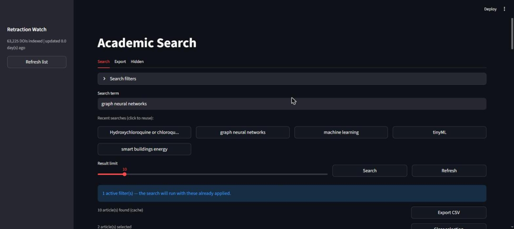
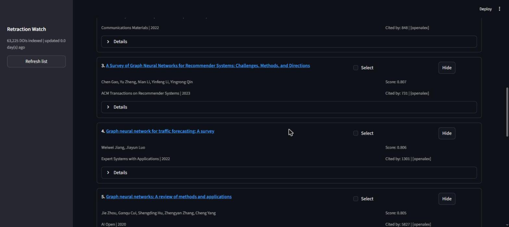
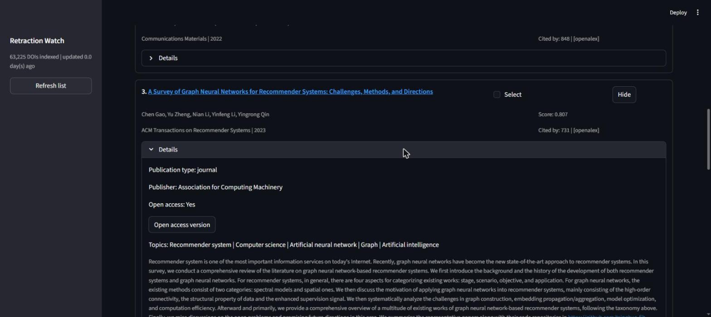
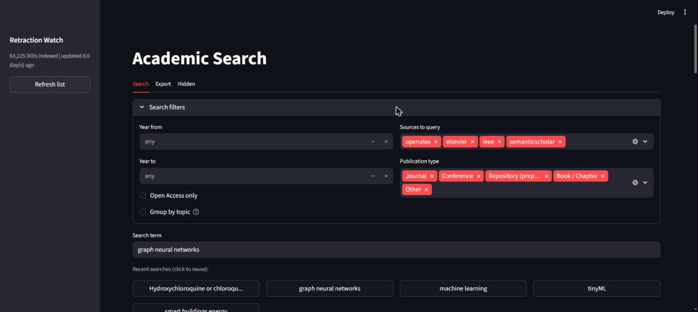
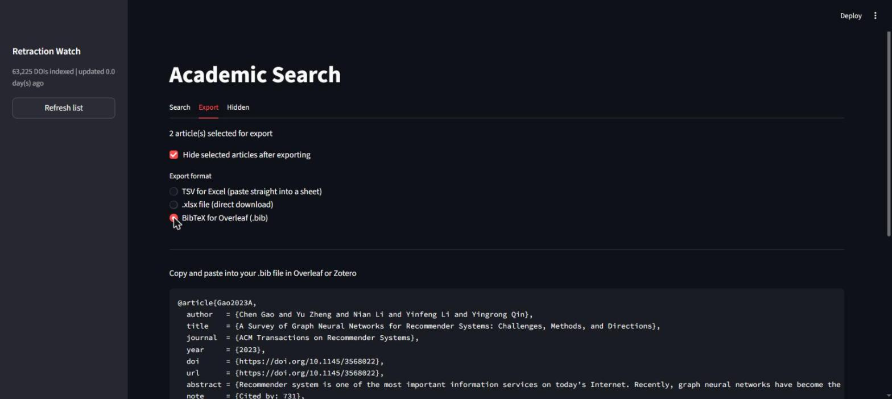
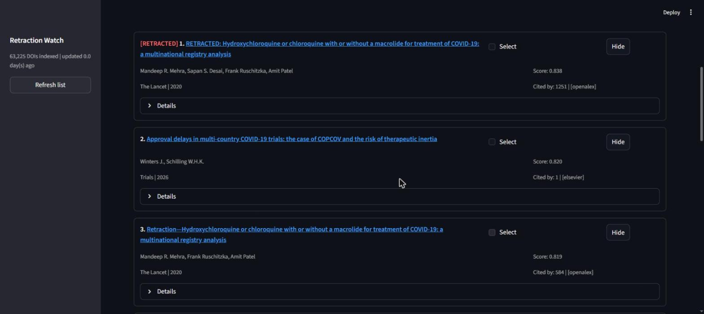

# Academic Search

**English** · [Português (pt-BR)](README.pt-BR.md)

Search four academic databases at once, collapse the duplicates they return, and
rank what's left by a weighted blend of semantic similarity, recency, source
authority and citation count — with retracted papers flagged automatically
against the Retraction Watch dataset.

Runs as a CLI or a Streamlit web app. Exports to CSV, TSV, xlsx and BibTeX.



## Why this exists

Searching for literature across OpenAlex, Scopus, IEEE Xplore and Semantic
Scholar means four tabs, four result formats, and the same paper showing up
three times under slightly different metadata. Each database also has its own
idea of relevance, and none of them tell you that the paper you just cited was
retracted last year.

This tool queries all four concurrently, merges the results into one ranked
list, and hands back something you can paste straight into Excel or Overleaf.

## What's actually hard about it

| | |
|---|---|
| **Cross-provider deduplication** | The same paper arrives from four APIs with four metadata shapes. Dedup keys on a normalized DOI (URL-prefixed and bare forms resolve to the same key) and falls back to a normalized title when a provider omits the DOI. Provider order decides which copy survives, so the richest record wins. |
| **Weighted ranking** | Results are scored as similarity 50% + recency 20% + source authority 15% + citations 15%. Similarity is a sentence-transformers embedding (`all-MiniLM-L6-v2`) against the query, with a keyword-overlap fallback if the model can't load — the tool degrades instead of crashing. Recency decays exponentially; citations are `log1p`-normalized so a 10,000-citation survey doesn't flatten everything else. |
| **Retraction flagging** | The Retraction Watch DOI set (via Crossref) is cached locally and matched at O(1) against every result, so a retracted paper is labelled before you cite it. |
| **Failure isolation** | Providers run concurrently under `asyncio.gather(return_exceptions=True)`. A dead API key or a 429 degrades that one source and is surfaced in the UI — it never turns into a silent "no results". |
| **Ranking headroom** | `--limit` caps the *final* list, not the fetch. Each provider is asked for `min(limit * 3, 100)` candidates so ranking has something to choose from: fetch → dedup → rank → filter → truncate. |

## Sources

> **Project status (October 2026): complete.** In use with OpenAlex, Elsevier/Scopus
> (institutional key) and Semantic Scholar. IEEE Xplore is implemented but has never
> been run with a real key — the author has none. No new features are planned.

| Provider | Coverage | Key required |
|----------|----------|--------------|
| **OpenAlex** | ~250M works, open catalogue | None — set `OPENALEX_EMAIL` to join the polite pool |
| **Elsevier / Scopus** | Scopus Search API | `ELSEVIER_API_KEY` + `ELSEVIER_INST_TOKEN` (institutional) |
| **IEEE Xplore** | IEEE journals and conferences | `IEEE_API_KEY` (free at developer.ieee.org) |
| **Semantic Scholar** | Graph API, strong CS coverage | Optional `SEMANTIC_SCHOLAR_API_KEY` (anonymous tier otherwise) |

With no keys at all, OpenAlex and Semantic Scholar still work; the others stay
inactive without failing the search.

## More screenshots

<table>
<tr>
<td width="50%"><br><sub>Ranked cards with score, venue, year, citation count and originating source.</sub></td>
<td width="50%"><br><sub>Expanded details: publication type, publisher, open-access link, topics, abstract.</sub></td>
</tr>
<tr>
<td width="50%"><br><sub>Pre-search filters: year range, which providers to query, publication type, OA-only, topic clustering.</sub></td>
<td width="50%"><br><sub>Select papers, export as BibTeX for Overleaf or Zotero — also TSV for Excel and .xlsx.</sub></td>
</tr>
</table>

### Retraction detection

Searching for the Surgisphere/Lancet COVID-19 registry study — retracted in
2020 and still cited over 1,200 times — flags it before you cite it:



## Quick start

**Prerequisites:** Python 3.11+ (3.14 is pinned in `.python-version`) and
[uv](https://docs.astral.sh/uv/).

```bash
git clone https://github.com/JoaoCarlos134/academic-search.git
cd academic-search
uv sync
```

Then copy the environment template and fill in whichever keys you have:

```bash
cp .env.example .env
```

| Variable | Required? | How to get it |
|----------|-----------|---------------|
| `OPENALEX_EMAIL` | No | Any email — puts you in the OpenAlex polite pool (better rate limits) |
| `ELSEVIER_API_KEY` | Scopus only | https://dev.elsevier.com/ (needs academic affiliation) |
| `ELSEVIER_INST_TOKEN` | Scopus only | Provided by Elsevier to activate the API |
| `IEEE_API_KEY` | IEEE only | https://developer.ieee.org/ (free) |
| `SEMANTIC_SCHOLAR_API_KEY` | No | https://www.semanticscholar.org/product/api — raises rate limits |
| `HTTPX_VERIFY_SSL` | No | Set to `false` behind a corporate proxy with a self-signed cert |
| `CACHE_DB` | No | Alternative path for the SQLite cache (default `academic_cache.db`) |

### CLI

```bash
# Simple search
uv run search main "machine learning"

# With filters
uv run search main "neural networks" --limit 20 --year-from 2022 --oa-only

# Restrict to one provider (saves Elsevier/IEEE quota)
uv run search main "transformers" -s openalex

# Save to a file
uv run search main "deep learning" -o results.csv
uv run search main "deep learning" -o refs.bib --format bibtex

# Clear the local search cache
uv run search clear-cache

# Download the retraction dataset (~64 MB, refresh weekly)
uv run search refresh-retractions
```

Flags for `search main`:

| Flag | Description |
|------|-------------|
| `--limit / -n` | Number of results (default 10) |
| `--output / -o` | Output file |
| `--format / -f` | `csv` or `bibtex` |
| `--year-from` | Earliest publication year |
| `--year-to` | Latest publication year |
| `--source / -s` | Filter by source (repeatable: `-s openalex -s ieee`) |
| `--oa-only` | Open Access articles only |

### Web

```bash
uv run academic-web
```

Opens `http://localhost:8501`. Three tabs:

- **Search** — query box, filters (year, source, publication type, OA, topic
  clustering), recent-search shortcuts, a refresh button to bypass the cache,
  and ranked result cards with per-card select/hide.
- **Export** — everything selected in the Search tab, as TSV (paste into
  Excel), .xlsx, or BibTeX (Overleaf / Zotero).
- **Hidden** — restore articles you've hidden from results.

The sidebar holds the Retraction Watch panel for downloading and refreshing the
retracted-paper dataset.

## How it works

```
cli.py / web.py
  └─ cache.get(query)              hit → return
                                   miss ↓
  └─ _search_all()  ──┬─ openalex ─┐
                      ├─ elsevier ─┤ asyncio.gather (concurrent, fault-isolated)
                      ├─ ieee ─────┤
                      └─ semantic ─┘
        └─ dedup_articles()        normalized DOI, then normalized title
        └─ score_articles()        similarity + recency + source + citations
        └─ mark_retracted()        Retraction Watch lookup
        └─ cache.store()           SQLite, 24h TTL
  └─ cluster_articles()            optional KMeans with auto-K
  └─ render / export
```

Scoring weights, in `src/ranking.py`:

| Component | Weight | Method |
|-----------|--------|--------|
| Similarity | 50% | sentence-transformers `all-MiniLM-L6-v2`, keyword-overlap fallback |
| Recency | 20% | `exp(-age / 5)` |
| Source | 15% | Per-provider authority weight |
| Citations | 15% | `log1p`-normalized |

## Tech

Python 3.14 · httpx (async) · SQLAlchemy + SQLite · sentence-transformers ·
scikit-learn · Typer + Rich · Streamlit · pytest (74 tests) · ruff · uv

## Contributing

Architecture notes, module-by-module responsibilities, conventions and a
walkthrough for adding a new provider live in
[CONTRIBUTING.md](CONTRIBUTING.md). Open items and change history are in
[`ROADMAP.txt`](ROADMAP.txt).
